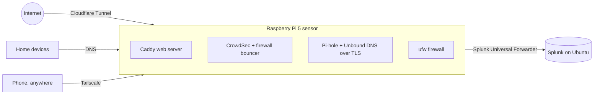

# Hi, I'm Bytebara 🦫💻

**Calm like a capybara, curious about every byte.** Entry-level security operations: monitoring, detection and automation, with the evidence labeled.

I'm working toward a SOC analyst or IT security role, coming from front-line technical support. I'm studying cybersecurity (A.S. in progress, planning a B.S. in Machine Learning and Cybersecurity) and I run a small home SOC lab to practice the job: collecting logs, writing searches, hunting and writing up what I find.

🌐 **Portfolio:** [bytebara.info](https://bytebara.info) (my site, *Quiet Signal*), with every skill and project labeled *Applied*, *Explored*, *Learning*, *Simulated* or *Planned*, so you can see what's been used for real.

---

### 🏠 Home SOC lab (running)

- **Sensor:** Raspberry Pi 5 with key-only SSH, ufw and automatic updates. It runs CrowdSec, serves my site through a Cloudflare Tunnel (no open router ports) and filters DNS with Pi-hole, encrypted upstream to Quad9.
- **SIEM:** Splunk on an Ubuntu PC, with an index, field extractions, saved searches and a dashboard built for the lab's logs: SSH, sudo, firewall, CrowdSec, web access and DNS.
- **Remote access:** Tailscale, with only individual machines shared and SSH allowed from Tailscale only.
- **Practice so far:** traced firewall blocks to a smart TV (benign), and ran a DNS hunt where long, rare names turned out to be game telemetry.

### 🔎 Interactive demos (synthetic data)

| Demo | What you do |
|---|---|
| [SOC alert triage](https://bytebara.info/soc-lab/) | Work an alert queue, make the call, compare with analyst notes |
| [DNS hunt](https://bytebara.info/dns-hunt/) | Use hunting leads to find generated domains, tunneling and beaconing among normal lookups |

### 🧰 Tools, labeled like the site

- **Running in my lab:** Splunk, CrowdSec, Pi-hole, Unbound, ufw, Linux (Debian, Ubuntu), Cloudflare Tunnel, Tailscale
- **Explored:** Wazuh, Sysmon, TheHive, Shuffle (SOAR), the VirusTotal API
- **Learning:** Python for defensive tooling, MITRE ATT&CK mapping

Bytebara is an alias; no personal contact details here by design. The site and lab scripts were developed with AI assistance and reviewed and run by me.
