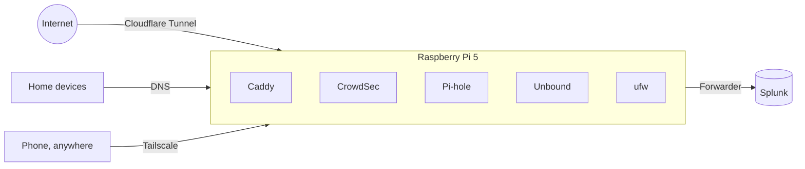
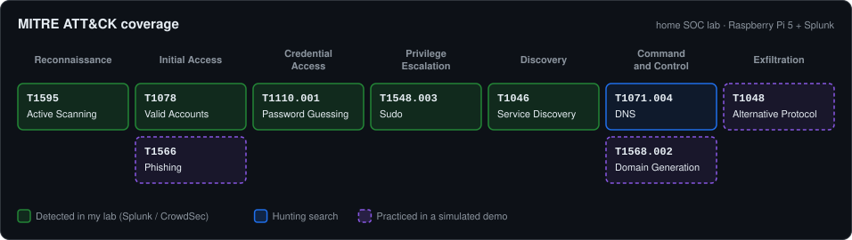

# Bytebara

<picture>
  <source media="(prefers-color-scheme: dark)" srcset="assets/terminal-dark.svg">
  <source media="(prefers-color-scheme: light)" srcset="assets/terminal-light.svg">
  
</picture>

I'm working toward cloud security engineering: designing environments that are secure from the start, and catching it fast when something goes wrong. I come from front-line technical support, where I learned that security problems are usually operations problems: a missed patch, a misconfiguration, an account with more access than it needs. Right now I run a home security lab to practice hardening, detection and response; next I'm moving into AWS.

**Portfolio:** [bytebara.info](https://bytebara.info) (*Quiet Signal*), with every skill and project labeled *Applied*, *Explored*, *Learning*, *Simulated* or *Planned*, so you can see what's been used for real.

---

### Home SOC lab (running)

- **Sensor:** Raspberry Pi 5 with key-only SSH, ufw and automatic updates. It runs CrowdSec, serves my site through a Cloudflare Tunnel (no open router ports) and filters DNS with Pi-hole, encrypted upstream to Quad9.
- **SIEM:** Splunk on an Ubuntu PC, with an index, field extractions, saved searches and a dashboard built for the lab's logs: SSH, sudo, firewall, CrowdSec, web access and DNS.
- **Remote access:** Tailscale, with only individual machines shared and SSH allowed from Tailscale only.
- **Practice so far:** traced firewall blocks to a smart TV (benign), and ran a DNS hunt where long, rare names turned out to be game telemetry.

### Detection coverage

<picture>
  <source media="(prefers-color-scheme: dark)" srcset="assets/attack-dark.svg">
  <source media="(prefers-color-scheme: light)" srcset="assets/attack-light.svg">
  
</picture>

How each technique is covered

| Technique | Coverage | Source |
|---|---|---|
| T1595 Active Scanning | Firewall blocks by port; web scanning paths (`wp-login`, `.env`, `.git/`) | ufw, Caddy logs in Splunk |
| T1046 Network Service Discovery | Blocked connection attempts to the sensor, by protocol and port | ufw |
| T1110.001 Password Guessing | Failed and invalid SSH logins by source; automatic bans | Splunk report, CrowdSec `ssh-bf` |
| T1078 Valid Accounts | Every successful SSH login with method and source, for review | Splunk report |
| T1548.003 Sudo | Every sudo command, by user | Splunk report |
| T1071.004 DNS | Long, many-part and rare domain names (hunting, not alerting) | Pi-hole logs in Splunk |
| T1568.002, T1048, T1566 | Generated domains, DNS tunneling, look-alike phishing domain | [DNS hunt demo](https://bytebara.info/dns-hunt/) (synthetic data) |

Searches: [savedsearches.conf](https://github.com/Bytebara/home-soc-lab/blob/main/splunk/server-app/quiet_signal_lab/default/savedsearches.conf)

### Interactive demos (synthetic data)

| Demo | What you do |
|---|---|
| [SOC alert triage](https://bytebara.info/soc-lab/) | Work an alert queue, make the call, compare with analyst notes |
| [DNS hunt](https://bytebara.info/dns-hunt/) | Use hunting leads to find generated domains, tunneling and beaconing among normal lookups |

### Next: cloud

AWS identity and access management, secure network design (VPCs, security groups), cloud logging and threat detection (CloudTrail, GuardDuty, sent to the same Splunk), and infrastructure as code. In the home lab first: network segmentation and containerized services.

### Tools

<picture>
  <source media="(prefers-color-scheme: dark)" srcset="assets/stack-dark.svg">
  <source media="(prefers-color-scheme: light)" srcset="assets/stack-light.svg">
  
</picture>

Bytebara is an alias; no personal contact details here by design.
